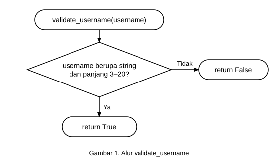
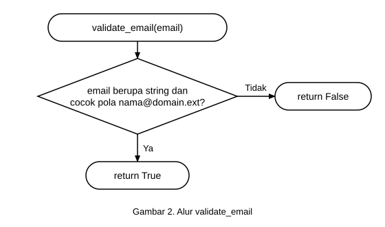
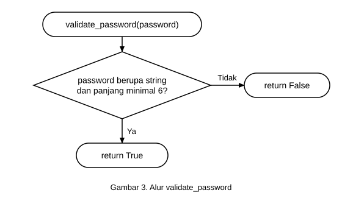
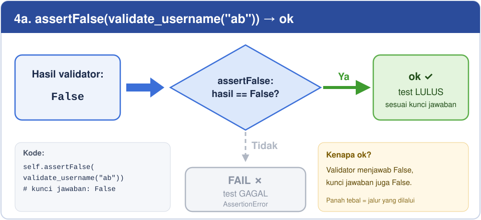
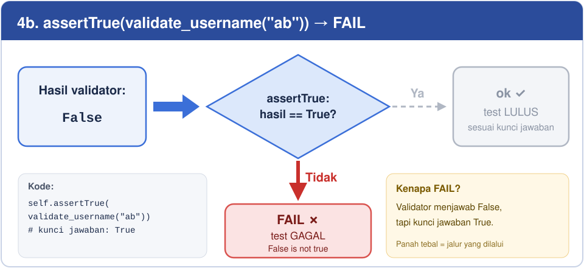

# Unit Test & Integration Test — Login/Register (Flask)

Contoh praktik pengujian perangkat lunak untuk materi **Uji Unit dan Uji Integrasi**.

## Struktur

```
.
├── app.py
├── docs
│   └── img            # diagram alur logika (SVG) untuk README
├── auth
│   ├── __init__.py
│   ├── logic_login_register.py
│   └── validators.py
├── templates
│   ├── login.html
│   └── register.html
├── tests
│   ├── __init__.py
│   ├── test_auth_logic.py
│   └── test_validation.py
└── users_db.json
```

| Kode yang diuji | Jenis pengujian | File test |
|---|---|---|
| `auth/validators.py` | Unit test | `tests/test_validation.py` |
| `auth/logic_login_register.py` (+ validators + file JSON) | Integration test | `tests/test_auth_logic.py` |

## Menjalankan

```bash
pip install -r requirements.txt

# Unit test
python3 -m unittest tests.test_validation -v

# Integration test
python3 -m unittest tests.test_auth_logic -v

# Semua test
python3 -m unittest discover -s tests -t . -v

# Jalankan aplikasi web
python3 app.py   # buka http://127.0.0.1:5000
```

Integration test memakai `unittest.mock.patch` untuk mengganti `DB_PATH` ke `test_users_db.json`,
sehingga data asli di `users_db.json` tidak tersentuh. File sementara dihapus di `setUp`/`tearDown`.

## Skenario Pengujian

> **Penting — bedakan dua hal ini:**
> - **Input diterima / ditolak** → hasil dari *kode* (validator/logic) mengembalikan `True` atau `False`.
> - **Test lulus (`ok`) / gagal (`FAIL`)** → hasil dari *test*, yaitu apakah hasil kode **sama dengan yang diharapkan**.
>
> Input yang **ditolak** (`False`) tetap membuat test **lulus (`ok`)** jika test memang mengharapkan `False`.
> Semua skenario di tabel bawah ini **lulus (`ok`)** pada kode saat ini.

### Alur logika dengan diagram (if else)

Sebuah test berjalan dalam **2 langkah**:

1. **Validator** memeriksa input lalu mengembalikan `True` (valid) atau `False` (tidak valid).
2. **Assert** membandingkan hasil itu dengan **kunci jawaban** yang kita tulis di test → `ok` atau `FAIL`.

Panah tebal berwarna = jalur yang dilalui oleh contoh input. Panah putus-putus abu-abu = jalur yang tidak dilalui.

#### Langkah 1 — Validator: input diterima atau ditolak?







#### Langkah 2 — Assert: hasil validator cocok dengan kunci jawaban?

Hasil validator untuk `"ab"` selalu `False`. Yang menentukan `ok` atau `FAIL` adalah **assert yang dipakai**:





> Kesimpulan: validator mengembalikan `False` **bukan berarti test gagal**.
> Test baru `FAIL` jika hasil validator **berbeda** dengan kunci jawaban di assert.

### Penjelasan `assertTrue`, `assertFalse`, dan `assertEqual`

| Assertion | Artinya | Test `ok` jika | Test `FAIL` jika | Pesan error saat FAIL |
|---|---|---|---|---|
| `assertTrue(x)` | "Saya yakin `x` bernilai **True**" | `x` adalah `True` | `x` adalah `False` | `AssertionError: False is not true` |
| `assertFalse(x)` | "Saya yakin `x` bernilai **False**" | `x` adalah `False` | `x` adalah `True` | `AssertionError: True is not false` |
| `assertEqual(a, b)` | "Saya yakin `a` **sama dengan** `b`" | `a == b` | `a != b` | `AssertionError: 'a' != 'b'` |

Contoh:

```python
self.assertTrue(validate_username("uwais_alqarni"))  # validator → True,  harapan True  → ok
self.assertFalse(validate_username("ab"))            # validator → False, harapan False → ok
self.assertTrue(validate_username("ab"))             # validator → False, harapan True  → FAIL (False is not true)
self.assertFalse(validate_username("uwais_alqarni")) # validator → True,  harapan False → FAIL (True is not false)
```

Aturan praktis:
- Pakai **`assertTrue`** untuk menguji input yang **valid** (harus diterima).
- Pakai **`assertFalse`** untuk menguji input yang **tidak valid** (harus ditolak).
- Pakai **`assertEqual`** untuk mencocokkan nilai persis, misalnya pesan error.

> Catatan: jika satu assertion di sebuah method gagal, assertion **di bawahnya dalam method yang sama tidak dijalankan**.

### Unit test — `tests/test_validation.py`

Menguji fungsi di `auth/validators.py` secara terpisah (tanpa file JSON, tanpa Flask).

| Fungsi | Input | Assertion | Hasil validator | Keterangan input | Status test |
|---|---|---|---|---|---|
| `validate_username` | `"uwais_alqarni"` | `assertTrue` | `True` | ✅ Diterima — 13 karakter | `ok` |
| `validate_username` | `"ab"` | `assertFalse` | `False` | 🚫 Ditolak — terlalu pendek (< 3) | `ok` |
| `validate_username` | `"a" * 21` | `assertFalse` | `False` | 🚫 Ditolak — terlalu panjang (> 20) | `ok` |
| `validate_username` | `123` | `assertFalse` | `False` | 🚫 Ditolak — bukan string | `ok` |
| `validate_email` | `"test@example.com"` | `assertTrue` | `True` | ✅ Diterima — format benar | `ok` |
| `validate_email` | `"invalid-email"` | `assertFalse` | `False` | 🚫 Ditolak — tanpa `@` | `ok` |
| `validate_email` | `"test@"` | `assertFalse` | `False` | 🚫 Ditolak — tanpa domain | `ok` |
| `validate_email` | `123` | `assertFalse` | `False` | 🚫 Ditolak — bukan string | `ok` |
| `validate_password` | `"123456"` | `assertTrue` | `True` | ✅ Diterima — 6 karakter | `ok` |
| `validate_password` | `"12345"` | `assertFalse` | `False` | 🚫 Ditolak — kurang dari 6 karakter | `ok` |
| `validate_password` | `""` | `assertFalse` | `False` | 🚫 Ditolak — kosong | `ok` |
| `validate_password` | `123` | `assertFalse` | `False` | 🚫 Ditolak — bukan string | `ok` |

### Integration test — `tests/test_auth_logic.py`

Menguji `auth/logic_login_register.py` bersama validator dan file JSON.
Fungsi mengembalikan pasangan `(success, message)`, dicek dengan `assertTrue`/`assertFalse` untuk `success`
dan `assertEqual` untuk `message`.

| Test | Langkah | Assertion | Hasil yang diharapkan | Keterangan | Status test |
|---|---|---|---|---|---|
| `test_register_success` | Register `alice` / `alice@example.com` / `123456` | `assertTrue` + `assertEqual` | `(True, "Registrasi berhasil")` | ✅ Register diterima | `ok` |
| `test_register_duplicate_username` | Register `bob`, lalu `bob` lagi dengan email lain | `assertFalse` + `assertEqual` | `(False, "Username sudah terdaftar")` | 🚫 Ditolak — username duplikat | `ok` |
| `test_register_duplicate_email` | Register `charlie`, lalu `dave` dengan email sama | `assertFalse` + `assertEqual` | `(False, "Email sudah digunakan")` | 🚫 Ditolak — email duplikat | `ok` |
| `test_login_success` | Register `eve`, lalu login `eve` / `123456` | `assertTrue` + `assertEqual` | `(True, "Login berhasil")` | ✅ Login diterima | `ok` |
| `test_login_wrong_password` | Register `frank`, lalu login dengan `wrongpass` | `assertFalse` + `assertEqual` | `(False, "Password salah")` | 🚫 Ditolak — password salah | `ok` |
| `test_login_user_not_found` | Login `nonexistent` tanpa register | `assertFalse` + `assertEqual` | `(False, "Username atau email tidak ditemukan")` | 🚫 Ditolak — user tidak ada | `ok` |

### Contoh output saat semua test lulus

```
test_validate_email (tests.test_validation.TestValidators.test_validate_email) ... ok
test_validate_password (tests.test_validation.TestValidators.test_validate_password) ... ok
test_validate_username (tests.test_validation.TestValidators.test_validate_username) ... ok

----------------------------------------------------------------------
Ran 3 tests in 0.000s

OK
```

## Cara Membuat Test Gagal (Simulasi)

Untuk melihat bagaimana unit test **mendeteksi bug**, ubah sementara salah satu kode di bawah,
jalankan test, lalu **kembalikan seperti semula**.

> Tips: jalankan dengan `python3 -B ...` atau hapus folder `__pycache__` setelah mengubah kode,
> supaya Python tidak memakai cache lama.

### Simulasi 1 — Bug di validator (unit test gagal)

Ubah aturan password di `auth/validators.py` dari minimal 6 menjadi minimal 8 karakter:

```python
# sebelum
return isinstance(password, str) and len(password) >= 6
# sesudah (bug disengaja)
return isinstance(password, str) and len(password) >= 8
```

Jalankan `python3 -B -m unittest tests.test_validation -v`:

```
test_validate_email ... ok
test_validate_password ... FAIL
test_validate_username ... ok

======================================================================
FAIL: test_validate_password (tests.test_validation.TestValidators.test_validate_password)
----------------------------------------------------------------------
Traceback (most recent call last):
  File ".../tests/test_validation.py", line 21, in test_validate_password
    self.assertTrue(validate_password("123456"))
AssertionError: False is not true

----------------------------------------------------------------------
Ran 3 tests in 0.000s

FAILED (failures=1)
```

**Artinya:** password `"123456"` seharusnya valid, tapi validator menolaknya.

Bug yang sama juga membuat **integration test** ikut gagal (5 dari 6), karena semua test di sana
mendaftarkan user dengan password `"123456"`. Ini contoh bagaimana bug di satu unit
merambat ke modul lain yang memakainya:

```
AssertionError: 'Password minimal 6 karakter' != 'Username sudah terdaftar'
...
FAILED (failures=5)
```

### Simulasi 2 — Pesan error berubah (integration test gagal)

Ubah pesan di `auth/logic_login_register.py` (ada 2 tempat):

```python
return False, "Password salah"    # sebelum
return False, "Password keliru"   # sesudah (bug disengaja)
```

Jalankan `python3 -B -m unittest tests.test_auth_logic -v`:

```
======================================================================
FAIL: test_login_wrong_password (tests.test_auth_logic.TestAuthLogic.test_login_wrong_password)
----------------------------------------------------------------------
  File ".../tests/test_auth_logic.py", line 51, in test_login_wrong_password
    self.assertEqual(msg, "Password salah")
AssertionError: 'Password keliru' != 'Password salah'
- Password keliru
+ Password salah

----------------------------------------------------------------------
Ran 6 tests in 0.002s

FAILED (failures=1)
```

**Artinya:** baris `-` adalah nilai yang **dihasilkan kode**, baris `+` adalah nilai yang **diharapkan test**.

### Simulasi 3 — Ekspektasi test yang salah

Bisa juga test-nya yang dibuat salah, misalnya di `tests/test_validation.py`:

```python
self.assertTrue(validate_username("ab"))   # seharusnya assertFalse
```

Hasilnya `AssertionError: False is not true`. Jadi saat test gagal, periksa dua kemungkinan:
**kodenya yang salah**, atau **ekspektasi test-nya yang salah**.

### Ringkasan status hasil test

| Status | Arti |
|---|---|
| `ok` | Hasil sesuai ekspektasi |
| `FAIL` | Assertion tidak terpenuhi (hasil ≠ ekspektasi) |
| `ERROR` | Terjadi exception tak terduga (mis. `ImportError`, `KeyError`) sebelum assertion selesai |
